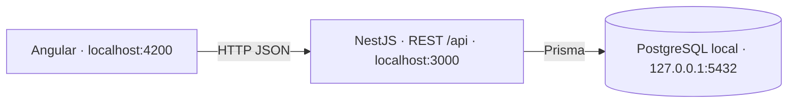

# Arquitetura · Etapa 1

O Angular carrega as rotas do menu sob demanda. Um serviço tipado centraliza HTTP. O dashboard consulta a saúde do processo e os totais do catálogo evologCypress separadamente. Integrações dispara a descoberta local de specs. Execuções e Relatórios aguardam os resultados do worker.

No backend, controladores NestJS recebem os DTOs, o serviço de projetos concentra as operações e o Prisma acessa o banco. A validação rejeita campos desconhecidos. O filtro global padroniza erros e evita devolver mensagens de infraestrutura. O logger em JSON registra falhas internas sem incluir o corpo do pedido ou a URL do banco. CORS permite a origem configurada e o servidor usa loopback por padrão. CORS serve à política de origem do navegador. Autenticação e autorização são gates de implantação.

Os repositórios têm instalação, lockfiles e builds independentes. O Compose provisiona o banco de desenvolvimento e o healthcheck do contêiner mede a disponibilidade do PostgreSQL. A aplicação possui um endpoint separado de saúde do processo. A versão `/api/v1` e os aliases `/api` compartilham os mesmos handlers.

A API REST atende às operações síncronas desta etapa. A etapa de monitoramento pode adicionar um canal WebSocket separado para eventos de execução, com contrato de mensagens e autorização próprios.

- [ADR 0001 · Repositórios e contrato REST](adr/0001-repositorios-e-rest.md)
- [ADR 0002 · Persistência e migrações locais](adr/0002-persistencia-local.md)
- [ADR 0003 · Área de trabalho por projeto](adr/0003-area-de-trabalho.md)
- [ADR 0004 · Catálogo local do evologCypress](adr/0004-catalogo-local-evolog.md)
- [ADR 0005 · Consulta e agendamento por tela](adr/0005-consulta-e-agendamento-por-tela.md)
